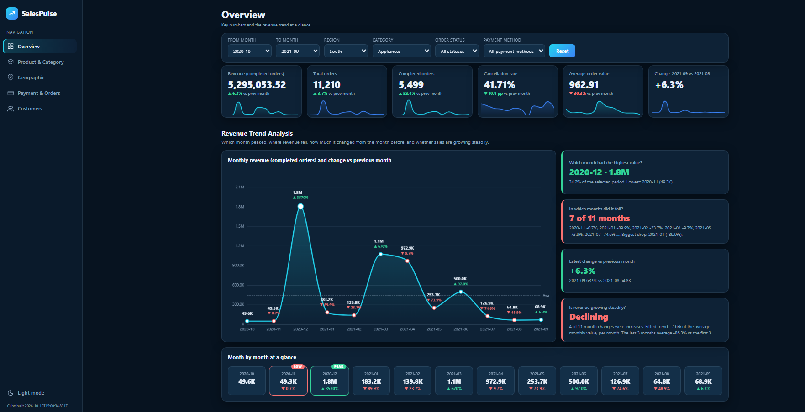

# SalesPulse BI

**Interactive Sales Performance & Revenue Analytics Dashboard**

## Project Overview
SalesPulse BI is a sales analytics project built with Google Sheets and Google Apps Script. It presents sales data through a web-based dashboard to support business performance monitoring and data-driven decisions.

## Objectives
- Monitor sales revenue and order performance.
- Analyze product and category performance.
- Compare sales across regions.
- Examine order statuses and cancellations.
- Identify potential opportunities for business improvement.

## Technology Stack
- Google Sheets
- Google Apps Script
- HTML
- CSS
- JavaScript
- Google Charts (if used in the project)

## Dashboard Preview

## Key Metrics
- Total Revenue
- Total Orders
- Average Order Value
- Cancellation Rate
- Monthly Revenue Trend

*Metric definitions and results will be documented after data validation.*

## Project Structure
- `apps-script/` — Apps Script source files
- `docs/screenshots/` — Dashboard screenshots

## Live Demo
[Open SalesPulse BI](https://script.google.com/macros/s/AKfycbzpQMUq0jSQ4SfpLRU3I7fGllEnoMHsECTakBqq8M6OVDxPMKYRSgkxRBApqlWJE8U/exec)

## Setup
1. Make a copy of the Google Sheets dataset.
2. Open Extensions → Apps Script.
3. Add the project source files.
4. Configure the spreadsheet reference and permissions.
5. Deploy as a Web App.
6. Open the deployed URL.

## Data Privacy
Use only data that is permitted to be shared publicly. Do not publish credentials, private spreadsheet links, or sensitive customer information.

## Project Status
Initial deployment and dashboard testing completed. Further improvements and documentation are ongoing.
